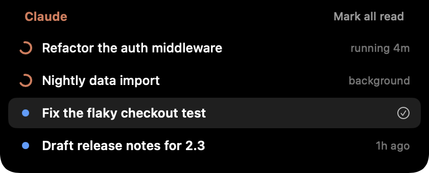

# Claude Island

A tiny macOS app that lives in the notch and shows what your Claude desktop sessions are doing.

<p align="center">
  
</p>

If you keep several Claude Code sessions going in the Claude desktop app, it's easy to lose track of which ones are still working and which ones finished while you were busy with something else. Claude Island keeps a quiet count next to the notch:

- **Left:** sessions that are running right now (orange spinner)
- **Right:** sessions with a reply you haven't read yet (blue dot)

<p align="center">
  
</p>

Hover over the notch to see the chat titles. Click one and Claude opens that conversation.

## Install

### Download (easiest)

1. Download `ClaudeIsland-1.0.0.zip` from the [latest release](https://github.com/joannemiki57/claude-island/releases/latest).
2. Unzip it and drag `ClaudeIsland.app` into your Applications folder.
3. Open it. The app isn't notarized by Apple, so the first launch gets blocked. Go to **System Settings > Privacy & Security**, scroll down and click **Open Anyway**. If you prefer the terminal:

   ```bash
   xattr -dr com.apple.quarantine /Applications/ClaudeIsland.app
   ```

To start it automatically, add it in **System Settings > General > Login Items**.

### Build from source

You need the Xcode command line tools (`xcode-select --install`). No Xcode project, no dependencies.

```bash
git clone https://github.com/joannemiki57/claude-island.git
cd claude-island
make install   # builds a universal app and copies it to /Applications
make login     # optional: start at login
```

Other targets: `make run`, `make demo`, `make uninstall`, `make zip`, `make clean`.

## Using it

| What you see | Meaning |
| --- | --- |
| Spinner, `running 4m` | Claude is working on a reply |
| Spinner, `background` | The reply is done, but the session left a command or subagent running |
| Blue dot, `5m ago` | Finished, and you haven't opened it yet |

- Opening a conversation in Claude clears it from the list.
- Hover a row and click the check mark to hide it from the widget. "Mark all read" hides all of them. This only affects the widget, not Claude's sidebar.
- Conversations you mark as unread in Claude's sidebar show up here too.
- Right-click the island to quit.

Want to see it without touching your real sessions? `make demo` (or `open ClaudeIsland.app --args --demo`) fills it with sample data.

## How it works

Everything stays on your Mac. The app makes no network requests and only reads files; it never writes to Claude's data.

Every 2 seconds it looks at:

- `~/Library/Application Support/Claude/claude-code-sessions/`: one JSON file per session with its title and turn timestamps. A session counts as running when its latest message came in after the last turn boundary.
- Claude's local storage (`Local Storage/leveldb`): the same unread list that drives the blue dots in Claude's sidebar. The app includes a small read-only LevelDB reader for this.
- The process list: tool shells still alive under a session's `claude` process (and recently updated subagent logs) mean that session is still busy in the background.

Clicking a row opens `claude://claude.ai/epitaxy/<session-id>`, the same link Claude itself uses.

These are internal files of the Claude app, not a public API. An app update could change them and break something here. If that happens, please open an issue.

## Requirements

- macOS 13 or later (Apple Silicon or Intel)
- The Claude desktop app, with sessions in the Code tab
- Looks best on a MacBook with a notch. On other displays it sits at the top center of the menu bar.

## Limitations

- Only Code tab sessions are tracked, not regular chats.
- Scheduled task runs are hidden, unless you mark one unread yourself.
- Unread items older than 48 hours are left out (hand-marked ones always show).

## Troubleshooting

**Nothing shows up.** Make sure the Claude desktop app is installed and you've used the Code tab at least once.

**The unread list doesn't match Claude's sidebar.** Run this to print what the app reads from Claude's storage:

```bash
/Applications/ClaudeIsland.app/Contents/MacOS/ClaudeIsland --dump-unread
```

## Uninstall

```bash
make uninstall
```

Or quit it from the right-click menu, delete `/Applications/ClaudeIsland.app` and remove it from Login Items.

## License

MIT. See [LICENSE](LICENSE).

This is an unofficial side project and isn't affiliated with or endorsed by Anthropic. Claude is a trademark of Anthropic.
